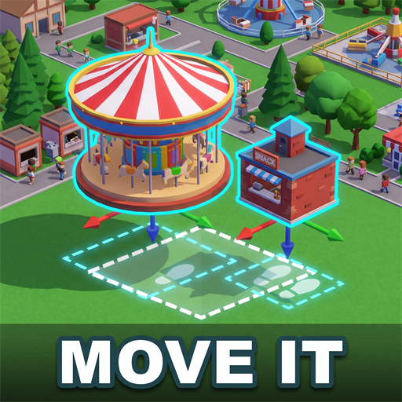

# Move It

A [Parkitect](https://www.themeparkitect.com/) mod to move or copy things you have already placed in your park, without demolishing and rebuilding them by hand.

[Steam Workshop page](https://steamcommunity.com/sharedfiles/filedetails/?id=3832679598)



Press **`** (the key left of 1 on a US keyboard), click an object, and place it somewhere else using the game's normal builder. Everything it knew comes with it. Press **Tab** along the way to place copies instead.

## What you can move

- Deco and props, fences and hedges included
- Path attachments: benches, trash bins, lamps
- Shops, restrooms, first aid rooms and ATMs
- Flat rides, with their entrance and exit following along
- Only the entrance or exit of a ride, including tracked rides and boat rides

## How to use it

- **`** starts picking. Hover an object to see whether it can be moved, then click it.
- Place it with the usual builder controls. **Esc** or **`** cancels and leaves the object where it was.
- To move only the entrance or exit of a flat ride, hold **Left Alt** while clicking it. On tracked rides and boat rides, a normal click already picks just that piece. The ride has to be closed first.
- To move several things at once, press **Shift + `**. Click or drag to add objects, right click to remove them, and press **Tab** to switch to a selection box. Press **`** to confirm, then place the group like a blueprint.
- To copy, press **Tab** before or after picking a single object. Each click places a new one while the original stays. **Esc** stops copying.
- If you copy more often than you move, choose **Copy** as the default action in the mod's settings.

These keys can be changed in the game's controls settings.

## What stays the same after moving

- Colors and size, and how much the object has lost in resale value
- Deco heights fine-tuned with Transform Anarchy
- Trash bin contents, and vandalism on path attachments
- Shops: name, products, prices, stock, depot, cleanliness and statistics
- Rides: name, fee, wait times, music, lights, settings, tower height and statistics, and whether they are open, closed or testing

A move is free as long as the object doesn't become worth more; if it does, you pay the difference, and there is never a refund. A copy costs the object's full price.

## What it won't move

Broken rides, shops and rides with a running advertising campaign, rides and deco linked to an effect box, rides synchronized with another ride, text and image signs, speakers, effect boxes, fireworks launchers, and whole tracked rides and boat rides. Hovering them tells you why.

## Good to know

- Moving a shop works like demolishing and rebuilding for its staff: a new shopkeeper walks over.
- A queue line doesn't follow a ride's entrance. Connect the queue again after moving.
- Multiplayer isn't supported yet: the mod turns itself off in online games.
- With the Undo Redo Undelete mod, undoing a move can reset a shop's stock and statistics. Move the object back with ` instead.

## Building

You need the .NET SDK and Parkitect installed.

```bash
dotnet build -c Release
```

The build copies the mod, Harmony and the preview into `Documents/Parkitect/Mods/move_it`. If the game or the mods folder is somewhere else:

```bash
dotnet build -c Release -p:ParkitectManaged="<Parkitect>/Parkitect_Data/Managed" -p:ModOutputDir="<mods folder>/move_it"
```

### Checking the patches

A Harmony patch that the game's Mono runtime can't apply closes the game while a park loads. `tools/mono_patch_check` applies every patch of the built mod inside the game's own Mono runtime, without opening the game:

```powershell
tools/mono_patch_check/run.ps1 -GameDir "<Parkitect>"
```

The last line of `tools/mono_patch_check/last_run.txt` is `ALL OK` when everything applied. It doesn't exercise the patches, so it can't tell whether a move works.

## Code

| File | What it does |
| --- | --- |
| `src/move_it_mod.cs` | Entry point, keys and settings UI |
| `src/move_behaviour.cs` | Reads the keys and drives the pick tool |
| `src/move_tool.cs` | Picking a single object, on top of the game's pipette |
| `src/move_group_tool.cs` | Picking a group, on top of the bulldozer's and blueprint tool's selection |
| `src/move_session.cs` | The local preview of a move in progress |
| `src/move_command.cs` | The move as one synchronized command, run the same way on every client |
| `src/move_patches.cs` | Harmony patches, inert unless a move is in progress |
| `src/move_rules.cs` | What is allowed to move or be copied |
| `src/object_state.cs`, `src/shop_state.cs`, `src/attraction_state.cs` | What an object, shop or flat ride keeps across a move |
| `src/move_it_settings.cs` | Settings |
| `src/texts.cs` | English and Brazilian Portuguese texts |

## Credits

Patches are made with [Harmony](https://github.com/pardeike/Harmony) (MIT), which is bundled with the mod.

## License

[MIT](LICENSE)
